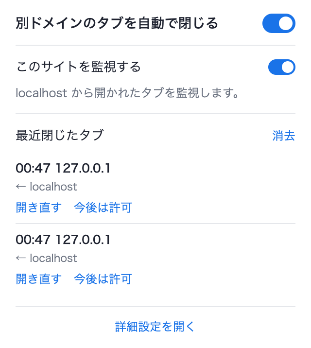
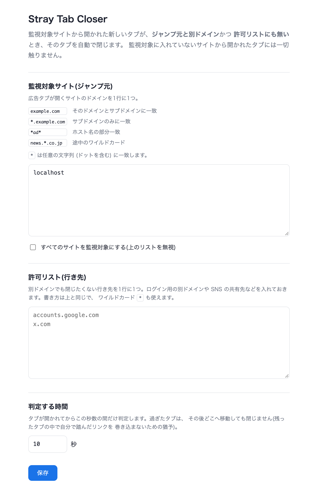

# Stray Tab Closer

クリックした覚えのないタブ (広告など) が勝手に開くサイト向けの Chrome 拡張 (MV3)。
**監視対象に指定したサイトから開かれた新しいタブ**が、**ジャンプ元と別ドメイン**で
**許可リストにも無い**とき、そのタブを自動で閉じます。



## 何を閉じて、何を閉じないか

新しいタブが開かれたとき、次の順で判定します。

| 条件 | 結果 |
| --- | --- |
| 自分で開いたタブ (ジャンプ元が無い。⌘T や ブックマーク) | 触らない |
| ジャンプ元が監視対象サイトでない | 触らない |
| 行き先がジャンプ元と同一ドメイン | 残す |
| 行き先が許可リストに一致 | 残す |
| 行き先が `http(s)` でない (`chrome-extension:` / 新しいタブ / `file:` など) | 触らない |
| 上記以外 | **閉じる** |

ドメインの比較は登録可能ドメイン (eTLD+1) 単位なので、`www.example.com` から
`shop.example.com` へのタブは「同一ドメイン」として残ります。

閉じたタブが手前に出ていた場合は、**ジャンプ元のタブへフォーカスを戻します**
(別ウィンドウで開いた広告を閉じたときも元のウィンドウへ戻ります)。裏で開かれた
タブを閉じたときは、見ている場所を動かさないようにフォーカスを触りません。

判定はタブが開かれてから既定10秒の間だけです。残ったタブの中で自分で踏んだ
別ドメインのリンクを巻き込まないための猶予で、秒数は設定で変えられます。

閉じたタブは履歴に残り、ポップアップから **開き直す** / **今後は許可** できます。

## インストール

1. `chrome://extensions` を開く
2. 右上の「デベロッパーモード」をオン
3. 「パッケージ化されていない拡張機能を読み込む」でこのディレクトリを選ぶ

## 設定

ポップアップ (ツールバーのアイコン):

- 拡張全体のオン / オフ
- 表示中のサイトを監視対象に入れる / 外す
- 最近閉じたタブの履歴 (開き直す・今後は許可)

詳細設定 (`options.html`):



- **監視対象サイト(ジャンプ元)** — 1行に1つ。書き方は下記
- **すべてのサイトを監視対象にする** — 上のリストを無視して全サイトを対象にする
- **許可リスト(行き先)** — 別ドメインでも閉じたくない行き先。書き方は監視対象と同じ
- **判定する時間** — タブが開かれてから何秒まで判定するか (1〜60秒)

### ドメインの書き方

監視対象サイト・許可リストのどちらも同じ書式です。

| 書き方 | 一致するホスト |
| --- | --- |
| `example.com` | `example.com` とそのサブドメイン全部 |
| `*.example.com` | サブドメインのみ (`example.com` 自身は対象外) |
| `*ad*` | ホスト名に `ad` を含むもの (部分一致) |
| `news.*.co.jp` | `news.a.co.jp` など |

`*` は任意の文字列 (ドットを含む) に一致します。`*` を含まない書き方は
従来どおり「そのドメイン + サブドメイン」の意味です。

対象になるのは **http / https のページだけ**です。`chrome-extension:` や
新しいタブページ、`file:` は、ジャンプ元にも行き先にもなりません。
これらの URL を設定欄に貼っても登録されず、ポップアップの
「このサイトを監視する」も無効になります。

## 制限

- タブは**閉じられてから**履歴に残ります。開くこと自体は止められません
  (MV3 にタブの生成をキャンセルする API が無いため、一瞬表示されることがあります)
- ドメインの区切りは公開サフィックスリストの完全な実装ではなく簡易判定です。
  意図と違う扱いになるドメインは許可リストで拾ってください
- 固定タブは閉じません

## 開発

判定ロジックは `rules.js` に閉じていて、chrome API に依存しません。

```bash
node --test test/rules.test.mjs
```

実機テストの手順は `.claude/skills/stray-tab-closer/SKILL.md` に記載しています。

## ライセンス

MIT
